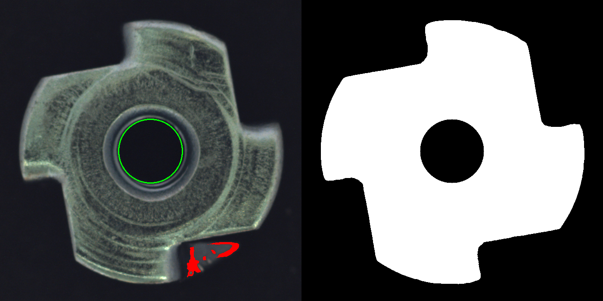
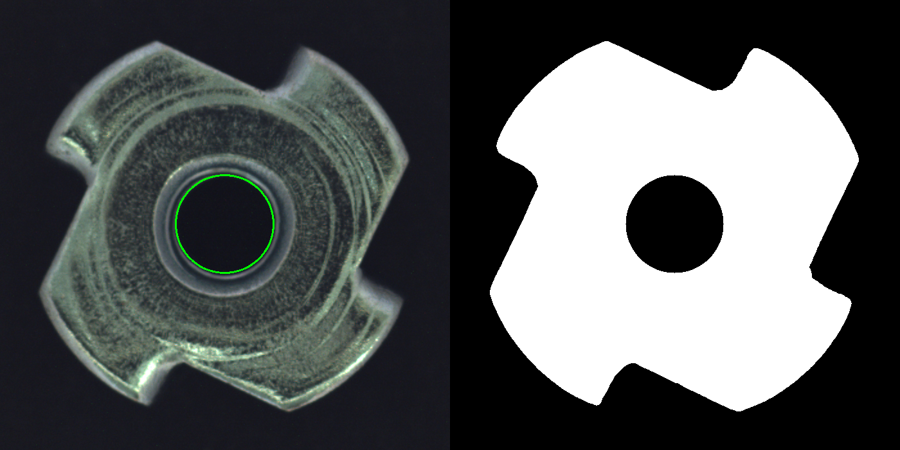
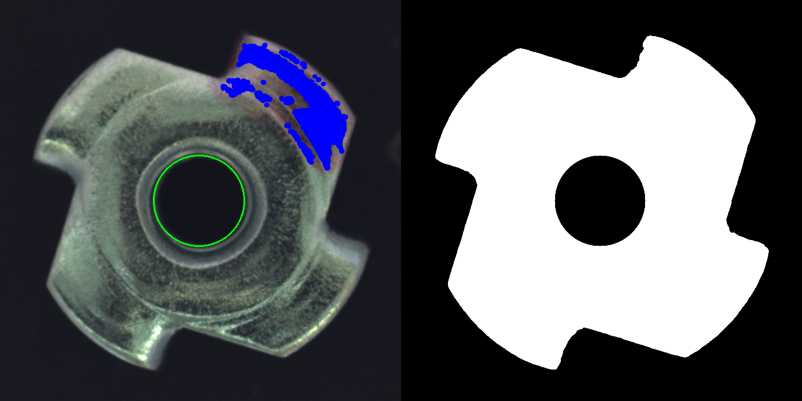

# Metal Nut Defect Detection with OpenCV

Hi there! This is my C++ project where I tried to build a small quality control program like the ones used on production lines: it looks at a photo of a metal nut and decides if the nut is OK or has a defect. I built it to learn classic computer vision with OpenCV (no deep learning) and to practice writing a C++ project that is split into modules.



_Left: result (red = bent tab found outside the nut, green = hole). Right: the nut mask._

## What I Learnt and Used

- **Segmentation with Otsu**: The background is dark and the nut is bright, so Otsu thresholding on the gray image separates them well. My first try used the saturation channel (it worked on a tomato photo I tested before), but on this dataset the background noise had more saturation than the nut.
- **Contours and Hierarchy**: `findContours` with `RETR_CCOMP` + `hierarchy` to find the biggest outer contour. Filling only that contour removes all the small dark spots on the surface.
- **Distance Transform**: I find the center hole as the biggest dark circle near the middle of the nut. Before, I used the biggest inner contour, but on some images the dark surface texture joined the hole and it became one huge blob.
- **Morphology**: `dilate` to build a ring around the nut and `MORPH_OPEN` to remove thin noise lines from shiny edges.
- **Lab Color Space**: The `a` and `b` channels were very stable on good nuts (std ~4-5), while `L` (brightness) changed a lot. So the color check only uses `a` and `b`.
- **Choosing Thresholds from Data**: Every limit in the code comes from measuring all 242 good images. I learnt this the hard way: solidity looked perfect on 5 images, but on all 220 training images the range was too wide to use.
- **Structs and Modules**: The code is split into `image_processor` (find the nut) and `defect_detector` (check the nut), and they pass their results with structs.
- **Batch Processing**: `cv::glob` + `std::filesystem` to check a whole folder and write the results to a CSV file.

## How It Works

1. **Find the nut** (`image_processor`): gray + blur → Otsu → biggest outer contour → mask → hole with `distanceTransform`
2. **Bent tab check** (`defect_detector`):
   - The bent part is darker than the nut, so Otsu cuts it out of the mask and the outline looks almost normal.
   - But it is still brighter than the background, so I count gray pixels in a ring 15-50 px outside the nut.
   - Also, a too long perimeter means the shape is wrong.
3. **Color stain check** (`defect_detector`): pixels on the nut whose Lab `a`/`b` values are outside the range of good nuts (mean ± 3 std).
4. **Decision**: `DEFECT` if `perimeter > 2300` or `ringPixels > 100` or `colorPixels > 700`.

## Results

I ran the program on every folder of the dataset:

| Folder         | Images | Found as DEFECT | Found as OK |
| -------------- | ------ | --------------- | ----------- |
| `train/good`   | 220    | **0**           | 220         |
| `test/good`    | 22     | **0**           | 22          |
| `test/bent`    | 25     | **25**          | 0           |
| `test/color`   | 22     | **14**          | 8           |
| `test/flip`    | 23     | 17              | 6           |
| `test/scratch` | 23     | 6               | 17          |

- No false alarms on the 242 good nuts.
- All bent nuts are found.
- I didn't write checks for `flip` and `scratch`, some of them are found because they also change the shape or color.

| Good nut                              | Color stain                               |
| ------------------------------------- | ----------------------------------------- |
|  |  |

_Blue = wrong color found on the nut._

## Limitations

- **Black stains are not found.** They only change brightness (`L`), and I don't check `L` because it changes too much on good nuts too.
- **Very small stains are missed.** The 9x9 opening that removes the noise on shiny edges also removes them.
- **Scratches and flipped nuts** don't have their own check yet.
- **Thresholds fit this dataset.** Numbers like 35 (background), 60 px (hole search) and the limits are for these photos. A different camera or light would need new measurements.
- The limits for good nuts come from the training images, but I also looked at the test images while choosing them, so the results above are a bit optimistic.

## Project Structure

```
include/vision/   headers (NutMask, InspectionResult)
src/
  image_processor.cpp   finds the nut and its hole
  defect_detector.cpp   bent tab and color checks, output image
  main.cpp              single image mode and folder mode
docs/images/      example outputs for this README
data/metal_nut/   the dataset (not in the repo, see below)
```

## Requirements

- A C++17 compiler (I use g++ 13 on Ubuntu 24.04 / WSL)
- CMake 3.28 or newer
- OpenCV 4 (I use 4.6.0 from apt: `sudo apt install libopencv-dev`)

## Dataset

The images come from the **MVTec Anomaly Detection (MVTec AD)** dataset, category `metal_nut`. The dataset is **not included** in this repo because of its license, so you need to download it yourself:

1. Download `metal_nut` from the [MVTec AD website](https://www.mvtec.com/company/research/datasets/mvtec-ad)
2. Extract it so the folders look like this:

```
data/metal_nut/
  train/good/
  test/good/ test/bent/ test/color/ test/flip/ test/scratch/
  ground_truth/
```

The dataset is made by MVTec Software GmbH and is licensed under [CC BY-NC-SA 4.0](https://creativecommons.org/licenses/by-nc-sa/4.0/). The example images in `docs/images/` are outputs of my program on MVTec AD images, so they are under the same license.

> Paul Bergmann, Michael Fauser, David Sattlegger, and Carsten Steger, "A Comprehensive Real-World Dataset for Unsupervised Anomaly Detection", IEEE Conference on Computer Vision and Pattern Recognition (CVPR), 2019.

## How to Run

1. **Build the project:**

```bash
mkdir build
cd build
cmake ..
cmake --build .
```

2. **Check one image** (prints the values and opens a window, also saves `nut_result.png`):

```bash
./mtest ../data/metal_nut/test/bent/001.png
```

3. **Check a whole folder** (writes `results.csv`):

```bash
./mtest ../data/metal_nut/test/color
```

### Example output

```
$ ./mtest ../data/metal_nut/test/bent/001.png
Perimeter: 2221.79
Ring pixels: 2075
Color pixels: 0
Result: DEFECT

$ ./mtest ../data/metal_nut/test/color
14 DEFECT / 8 OK
The results have been written to the results.csv file..
```

`results.csv` looks like this:

```
file,perimeter,ringPixels,colorPixels,result
../data/metal_nut/test/color/012.png,2231.19,0,16247,DEFECT
```

## About AI Assistance

I used an AI assistant (Claude) as a mentor and code reviewer during this project. It told me what to research, reviewed my code after each step and tested my changes on all 335 images.

I wrote the segmentation, the color check, the struct/function refactor, the folder mode with CSV output and the split into modules myself. We did the measurements together: I added the values to the code (perimeter, ring pixels, Lab mean/std, color pixels) and we went through the numbers on all images to pick the thresholds. The bent tab and hole detection also came out of these measurements; Claude wrote the first version and we simplified it together afterwards. Claude also helped with the comments and this README.
